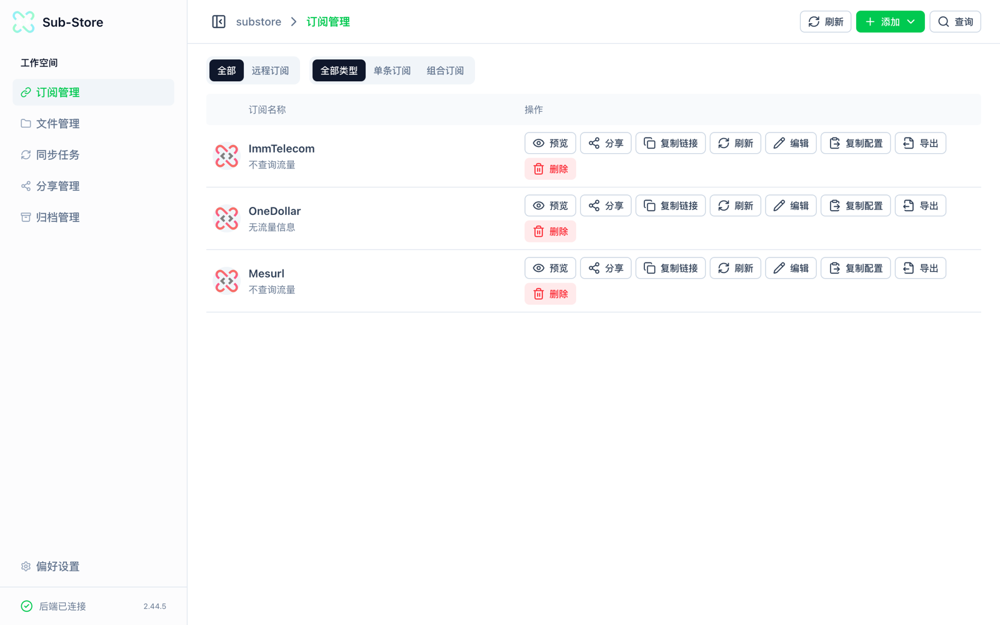
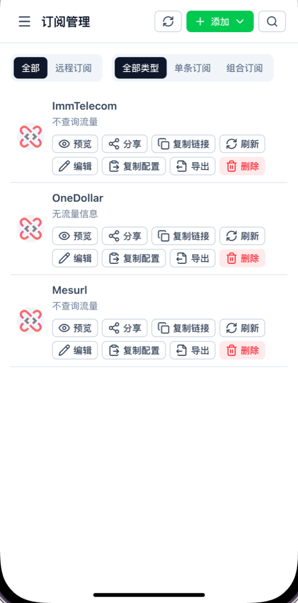

<div align="center">
  
  <h1>Sub-Store Front-End</h1>
  <p>Sub-Store 订阅管理前端，适配桌面端与移动端。</p>
</div>

本仓库复刻自 [sub-store-org/Sub-Store-Front-End](https://github.com/sub-store-org/Sub-Store-Front-End)，在原项目基础上重新设计界面，迁移至 Nuxt UI，并调整了导航、资源编辑、节点预览及移动端布局。感谢上游作者与贡献者提供的功能和持续维护。

订阅解析、转换等核心能力由 [Sub-Store 后端](https://github.com/sub-store-org/Sub-Store)提供，支持 Quantumult X、Loon、Surge、Stash、Shadowrocket 等客户端。使用本前端前，请先准备可连接的 Sub-Store 后端。

## 界面预览

<table>
  <tr>
    <th width="76%">桌面端</th>
    <th width="24%">移动端</th>
  </tr>
  <tr>
    <td valign="top"><a href="docs/images/desktop.png"></a></td>
    <td valign="top"><a href="docs/images/mobile.png"></a></td>
  </tr>
</table>

## 功能

- 管理单条订阅与组合订阅，筛选、查询、编辑并导出配置。
- 管理文件、同步任务、分享链接和归档。
- 在独立预览页面查看节点、筛选节点并比较处理前后的结果。
- 在偏好设置中管理后端连接、外观、Gist 同步及备份恢复。
- 支持浅色与深色主题、中文 / 英文 / 俄文，以及 PWA 安装。

桌面端使用侧边栏导航；移动端收起侧边栏、精简顶部操作，表单按单列排列，设置标签和节点表格可横向滑动。

## 本地开发

使用 `.node-version` 指定的 Node.js 24.22.1，包管理器为 `package.json` 固定的 pnpm 11.0.9。

```bash
git clone https://github.com/SlippinDylan/Sub-Store-Front-End.git
cd Sub-Store-Front-End
git switch redesign
corepack enable
pnpm install --frozen-lockfile
```

在项目根目录新建 `.env.development.local`，将地址改为自己的后端地址：

```dotenv
VITE_API_URL=http://127.0.0.1:3000
```

```bash
pnpm dev
```

默认访问地址为 <http://localhost:8888>。也可以在页面的「偏好设置 → 后端连接」中添加或切换后端。

### 常用命令

| 命令 | 用途 |
| --- | --- |
| `pnpm check:types` | TypeScript 类型检查 |
| `pnpm check:locales` | 检查三种语言的翻译键是否一致 |
| `pnpm test:ui` | 运行现有测试 |
| `pnpm build` | 类型检查并构建，产物输出至 `dist/` |
| `pnpm preview` | 本地预览构建产物 |

当前界面使用 Vue 3、TypeScript、Vite、Pinia、[Nuxt UI](https://ui.nuxt.com/) 和 Tailwind CSS；图标来自 [Lucide](https://lucide.dev/icons/)，名称采用 `i-lucide-*` 格式。具体版本以 `package.json` 和锁文件为准。

## 部署

### 静态站点

```bash
pnpm build
```

将 `dist/` 部署到静态站点服务。项目使用 History 路由，需要将页面路由回退到 `index.html`，否则直接打开编辑、预览等地址时可能返回 404。

生产构建的默认后端为 `https://sub.store`。需要修改时，在 `.env.production.local` 中设置 `VITE_API_URL` 后重新构建，也可以在页面中配置后端连接。

### Docker Compose（推荐）

将仓库中的 [compose.yaml](compose.yaml) 保存到部署目录，然后执行：

```bash
docker compose up -d
```

默认从 GHCR 拉取 `ghcr.io/slippindylan/sub-store-front-end:latest`，访问 <http://localhost:8080>，在「偏好设置 → 后端连接」中配置后端。镜像支持 AMD64 和 ARM64，不包含 Sub-Store 后端，也不需要挂载数据目录。

更新至最新正式版：

```bash
docker compose pull
docker compose up -d
```

`latest` 不会自动更新正在运行的容器。需要同时部署多套实例时，指定不同的项目名和端口：

```bash
FRONTEND_PORT=8081 docker compose -p sub-store-secondary up -d
```

后续管理这套实例时也使用相同的项目名和端口。若需回退，将 Compose 的 `image` 改为具体版本，例如 `ghcr.io/slippindylan/sub-store-front-end:0.1.0`，再执行上述更新命令。

镜像内的前端资源已在构建时生成，容器运行时设置 `VITE_API_URL` 不会修改后端地址，请通过页面配置连接。

### 自行构建镜像

仓库提供多阶段 Dockerfile，构建时运行测试、翻译检查和应用构建，运行时由 Nginx 提供静态文件服务：

```bash
docker build -t sub-store-front-end .
docker run -d --name sub-store-front-end -p 8080:80 sub-store-front-end
```

访问 <http://localhost:8080>，在偏好设置中配置后端连接。此容器仅提供前端，不包含 Sub-Store 后端。`.local` 环境文件不会进入 Docker 构建上下文。

## 版本与镜像发布

本分支从 `0.1.0` 开始独立编号。`package.json` 中的版本、Git 标签和镜像版本对应，例如 `0.1.0` → `v0.1.0` → `:0.1.0`。

- 推送 `redesign` 分支中影响镜像的变更时，发布 `:redesign` 开发镜像。
- 推送 `v*` 标签时，先检查标签与 `package.json` 版本一致，再构建并发布对应版本镜像。正式版本同时更新 `:latest`，预发布版本不更新它。
- GitHub Release 用于记录发布说明；镜像由 GitHub Actions 发布到 GHCR。

发布前更新 `package.json` 版本并完成验证，再提交、推送分支和对应标签。首次发布后，在 GitHub 的 Package 设置中将镜像可见性设为 Public，部署机器才能免登录拉取。

## 来源与致谢

- [Sub-Store-Front-End](https://github.com/sub-store-org/Sub-Store-Front-End)：本仓库的上游前端项目。
- [Sub-Store](https://github.com/sub-store-org/Sub-Store)：订阅管理与转换的核心后端。
- [KOP-XIAO](https://github.com/KOP-XIAO/QuantumultX)：resource-parser。
- [Orz-3](https://github.com/Orz-3) 与 [58xinian](https://github.com/58xinian)：原项目使用的图标。

沿用原项目的 GPL-3.0 许可证，详见 [LICENSE](LICENSE)。
